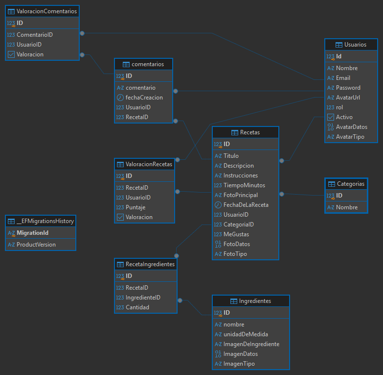

# SaborNet

SaborNet es una plataforma web de recetas desarrollada con arquitectura MVC. Busca reunir en un solo espacio recetas organizadas por categoría para que las personas puedan descubrir preparaciones, compartir sus conocimientos culinarios y participar en una comunidad gastronómica.

Los usuarios registrados pueden publicar recetas con fotografías, ingredientes e instrucciones, y participar mediante comentarios. Las personas visitantes pueden explorar el contenido público e iniciar el registro para acceder a las funciones de participación.

## Funcionalidades

- Consulta y búsqueda de recetas y categorías.
- Publicación de recetas con imágenes, instrucciones y sus ingredientes.
- Perfiles con avatar y autenticación con roles.
- Comentarios y valoraciones en recetas y comentarios.
- Gestión de ingredientes con un ABM reactivo en Vue.

La aplicación cuenta con los roles `Usuario`, `Cocinero_Amateur`, `Chef` y `Administrador`. Las secciones de gestión administrativa están restringidas al rol Administrador. La versión actual incluye valoraciones, además de comentarios.

## Tecnologías

- ASP.NET Core MVC con .NET 10
- Entity Framework Core
- PostgreSQL
- Vue 3 y `fetch` para el ABM de ingredientes
- SignalR para funciones en tiempo real

## Modelo de datos

El modelo incluye usuarios, recetas, categorías, ingredientes, comentarios y valoraciones. Un usuario puede publicar varias recetas y cada receta pertenece a una categoría. `RecetaIngredientes` resuelve la relación muchos a muchos entre recetas e ingredientes y almacena la cantidad utilizada. Los comentarios y las valoraciones también relacionan usuarios con recetas o comentarios.



El script de creación del esquema está en [`backend/Database/DB.sql`](backend/Database/DB.sql).

## Requisitos

- .NET SDK 10
- PostgreSQL

## Ejecución local

1. Crear la base de datos `sabornetdb` en PostgreSQL.
2. Ejecutar [`backend/Database/DB.sql`](backend/Database/DB.sql) conectado a esa base.
3. Configurar la conexión y la clave JWT desde la carpeta `backend`:

   ```bash
   dotnet user-secrets set "ConnectionStrings:DefaultConnection" "Host=localhost;Port=5432;Database=sabornetdb;Username=postgres;Password=TU_PASSWORD"
   dotnet user-secrets set "Jwt:Key" "REEMPLAZAR_POR_UNA_CLAVE_DE_AL_MENOS_32_CARACTERES"
   ```

4. Iniciar la aplicación:

   ```bash
   dotnet run
   ```

La aplicación estará disponible en `http://localhost:5133` .

## API con JWT

- `POST /api/auth/login`: recibe email y contraseña y devuelve un token Bearer.
- `/api/ingredientes`: permite consultar ingredientes; las operaciones de escritura requieren un token JWT de un usuario Administrador.
